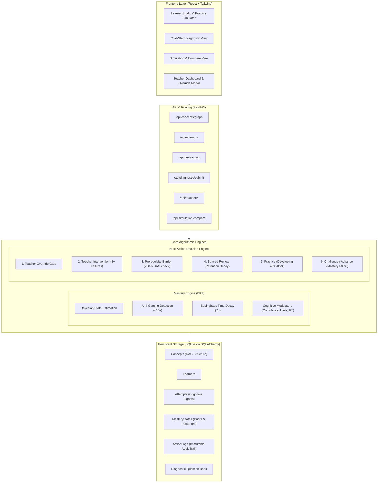

#frontend
cd d:\Downloads\hackthon\frontend

# Start Vite React development server
npm run dev
-----------------------------------------------------------------------------
#backend
cd d:\Downloads\hackthon\backend

# Seed the initial Algebra DAG & demo learners (if not already seeded)
py seed_data.py

# Start the FastAPI backend
py -m uvicorn app.main:app --host 127.0.0.1 --port 8000 --reload

---------------------------------------------------------------------------------

# MasteryFlow
### Explainable Adaptive Learning & Intervention Engine
**YUVA Megathon 2026 — EduGenAI Track (Intelligent Educational Systems)**

---

## 🎯 Executive Overview

**MasteryFlow** is an explainable adaptive learning and intervention engine. Unlike opaque LLM chatbots or black-box recommenders, MasteryFlow is built on an **inspectable, deterministic Bayesian Knowledge Tracing (BKT) engine** and a **Directed Acyclic Graph (DAG) prerequisite architecture**. 

Every single decision the engine makes—whether to advance, remediate a prerequisite, enforce spaced review, assign a challenge, or escalate to a human teacher—comes with a **human-readable, number-grounded justification** directly computed from cognitive evidence, behavioral pacing, and prerequisite validation.

---

## 🏗️ Architecture Diagram



---

## 🧮 Mathematical Formulation of the Mastery Engine

The core mastery calculation uses an **Extended Bayesian Knowledge Tracing (BKT)** algorithm augmented with cognitive evidence weights and anti-gaming guardrails.

### 1. Standard Bayesian Knowledge Tracing Base
Let $P(L_t)$ denote the probability that the learner has mastered the concept at attempt $t$.
- $P(L_0)$: Prior mastery probability ($0.15$ baseline, or derived from diagnostic assessment).
- $P(T)$: Probability of transition / learning ($0.12$ for Easy, $0.18$ for Medium, $0.25$ for Hard).
- $P(G)$: Probability of a correct guess without mastery ($0.20$ base).
- $P(S)$: Probability of a slip / careless error despite mastery ($0.10$ base).

#### Posterior Update Given Observation $O_t \in \{1, 0\}$:
- **If Correct ($O_t = 1$):**
  $$P(L_t \mid O_t = 1) = \frac{P(L_{t-1}) \cdot (1 - P(S))}{P(L_{t-1}) \cdot (1 - P(S)) + (1 - P(L_{t-1})) \cdot P(G)}$$

- **If Incorrect ($O_t = 0$):**
  $$P(L_t \mid O_t = 0) = \frac{P(L_{t-1}) \cdot P(S)}{P(L_{t-1}) \cdot P(S) + (1 - P(L_{t-1})) \cdot (1 - P(G))}$$

### 2. Cognitive Modulations on Guess ($P(G)$) and Slip ($P(S)$)
Evidence is modulated by cognitive and behavioral dimensions:
1. **Hint Usage ($H_t \in \{0, 1\}$)**:
   - If $H_t = 1$, the scaffolded nature of the attempt boosts $P(G) \leftarrow 0.75$. Correctness with a hint contributes minimal positive belief of independent mastery.
2. **Self-Reported Confidence ($C_t \in [1, 5]$)**:
   - $C_t = 1$ (Guess) and correct: $P(G) \leftarrow 0.55$ (lucky guess discount).
   - $C_t \ge 4$ (Confident) and correct: $P(G) \leftarrow 0.10$ (strong authentic signal).
   - $C_t \ge 4$ and incorrect: $P(S) \leftarrow 0.04$ (overconfident error signals a conceptual misconception, penalizing posterior mastery more heavily).
3. **Response Time ($RT$)**:
   - Rapid guess ($RT < 3.5\text{s}$ and correct): $P(G) \leftarrow 0.70$.
   - Prolonged struggle ($RT > 2.5 \times \text{benchmark}$): transition probability $P(T) \leftarrow P(T) \cdot 0.70$.

### 3. Anti-Gaming Session Throttling
- If an attempt occurs within $\Delta t < 10\text{s}$ of the preceding attempt on the same concept:
  - `is_rapid_guess = True`.
  - Evidence weight $w = 0.15$ (85% reduction in learning transition).
  - Absolute positive mastery delta is capped: $\Delta M \le +0.025$.

### 4. Learning State Transition
$$P(L_{t+1}) = P(L_t \mid O_t) + (1 - P(L_t \mid O_t)) \cdot P(T) \cdot w$$

### 5. Ebbinghaus Forgetting Factor (Time Decay)
If $\Delta t_{\text{days}} > 7\text{ days}$ since the last practice attempt:
$$\text{decay\_ratio} = e^{-\lambda \cdot (\Delta t_{\text{days}} - 7)} \quad (\lambda = 0.05)$$
$$M_{\text{decayed}} = M_{\text{baseline}} + (M_{\text{raw}} - M_{\text{baseline}}) \cdot \text{decay\_ratio}$$
where $M_{\text{baseline}} = 0.35$. Concepts with active decay automatically schedule a `Review` directive.

---

## 🚦 Deterministic Next-Action Decision Rules

The Next-Action Policy Engine evaluates rules in strict hierarchical pedagogical order:

| Priority | Action | Trigger Condition | Explainable Reason Template |
| :---: | :--- | :--- | :--- |
| **1** | `TeacherIntervention` | $\ge 3$ consecutive failures, or $\ge 2$ failures with hints and $M < 0.40$ | `"Struggle detected on {concept}: {fails} consecutive failures ({hints} hints used). Mastery is {M}%. Escalating to Teacher Intervention."` |
| **2** | `RemediatePrerequisite` | Any direct DAG prerequisite has mastery $< 50\%$ | `"Prerequisite barrier: Review '{prereq}' ({p_score}%) before practicing '{concept}'. Foundational competence must exceed 50%."` |
| **3** | `Review` | Inactive $> 7$ days with decay applied ($M_{\text{raw}} \ge 0.65$) | `"Spaced review triggered for '{concept}': Concept untouched for {days} days. Retention decayed from {raw}% to {curr}%. Refresher scheduled."` |
| **4** | `Practice` | Developing zone: $0.40 \le M < 0.85$ and prerequisites satisfied | `"Target concept '{concept}' is developing at {M}% mastery (target: ≥85%). {n} attempts recorded; continue adaptive practice."` |
| **5** | `Challenge` | $M \ge 0.85$, prerequisites $\ge 0.80$, confidence $\ge 4.0$, 100% recent accuracy | `"Exceptional mastery confirmed on '{concept}' ({M}%). Learner showed high confidence ({conf}/5) and 100% accuracy. Issuing stretch challenge."` |
| **6** | `Advance` | $M \ge 0.85$ and prerequisites satisfied | `"Mastery achieved on '{concept}' ({M}% ≥ 85%). Prerequisites satisfied. Path unlocks progression to '{next_concept}'."` |

---

## 🧪 Comprehensive Test Suite (5 Required Cases)

Run tests directly with:
```bash
cd backend
py -m pytest test_mastery_flow.py -v
```

All 5 core test cases pass with 100% reproducibility:

1. **`test_case_1_normal_correct_streak`**:
   - Submits 4 confident, unhinted correct attempts on `c_fractions`.
   - Mastery monotonically rises from $0.15 \to 0.99$ ($> 85\%$).
   - Recommends `Challenge` with explanation citing $99\%$ mastery and $5/5$ confidence.
2. **`test_case_2_prerequisite_weak_learner`**:
   - Learner attempts `c_ratios` while prerequisite `c_fractions` is at $34\%$ ($< 50\%$).
   - Progression is blocked; returns `RemediatePrerequisite` focusing on `c_fractions` with exact numeric citation `"34.0%"`.
3. **`test_case_3_anti_gaming_rapid_guessing`**:
   - Submits consecutive attempts on same concept $4\text{s}$ apart ($< 10\text{s}$).
   - Flags `is_rapid_guess = True`, discounts evidence weight to $0.15$, caps mastery delta at $\le +0.025$.
4. **`test_case_4_long_gap_time_decay`**:
   - Learner attained $86\%$ mastery, but remained inactive for $20$ days ($> 7\text{d}$).
   - Ebbinghaus decay function reduces mastery to $48\%$, sets `decay_applied = True`, and recommends `Review`.
5. **`test_case_5_teacher_override_flow`**:
   - Educator forces action to `Review` with notes: *"Oral assessment showed minor hesitation."*
   - Logs with `was_teacher_override = True`, preserves note, and Next Action engine honors the educator's directive.

---

## 🛠️ Tech Stack & Setup Instructions

- **Backend**: Python 3.10+ / 3.14, FastAPI, Uvicorn, SQLAlchemy 2.0, SQLite, Pydantic v2, Pytest.
- **Frontend**: React 19, Vite, Tailwind CSS v4, Lucide React icons.
- **Database**: File-based SQLite (`masteryflow.db`) that persists across restarts.

### 1. Start the Backend
Open a terminal in the project directory:
```bash
cd backend
# Seed concept DAG & demo learner profiles
py seed_data.py

# Start FastAPI server on port 8000
py -m uvicorn app.main:app --host 127.0.0.1 --port 8000 --reload
```
The backend API is now live at `http://127.0.0.1:8000` (Swagger docs at `http://127.0.0.1:8000/docs`).

### 2. Start the Frontend
Open a second terminal in the project directory:
```bash
cd frontend
npm install
npm run dev
```
Open **`http://localhost:5173`** in your browser.

*(Note: The backend also mounts `frontend/dist` directly, so visiting `http://127.0.0.1:8000` serves the built full-stack app unified!)*

---

## 🎭 Step-by-Step Live Demo Script for Judges

Follow this exact 6-step walkthrough during the live presentation:

### Step 1: Load Seeded Profiles & Explore Concept DAG
1. Navigate to `http://localhost:5173` (`Learner Studio`).
2. Show the **Algebra Prerequisite DAG Graph**:
   - 10 real concepts forming 5 depth tiers (Arithmetic $\to$ Fractions $\to$ Ratios $\to$ Percentages).
   - Nodes color-coded by mastery (Emerald for Mastered, Sky for Developing, Rose for Locked, Amber for Review).
3. Select **Aria Chen** in the top dropdown:
   - Notice her solid prerequisites (Arithmetic 94%, Integers 91%, Fractions 89%).
   - Her focus concept `Ratios & Proportions` is at 99% mastery with directive: **`Challenge`**.

### Step 2: Cold-Start Diagnostic for a New Third Learner
1. Click the **`Cold-Start Diagnostic`** tab in the navbar.
2. Enter student name **`Rohan Sharma`** (or keep default `Elena Rostova`).
3. Take the 6 diagnostic questions across root arithmetic, integers, fractions, variables, and ratios.
4. Click **`Submit Diagnostic & Generate Pathway`**:
   - Show judges the **Derived Priors Matrix**: explain that root concepts start at derived scores (e.g. 72% or 20%) rather than an arbitrary 0%, and priors are propagated down the DAG!
5. Click **`Launch Personalized Pathway`** to enter Learner Studio with Rohan's calibrated profile.

### Step 3: Interactive Practice & Mastery Engine Telemetry
1. In Learner Studio, scroll to the **Interactive Learning Simulator**.
2. Select an option, adjust **Confidence** to 5, and click **`Submit Attempt & Update Mastery State`**.
3. Point out the **BKT Engine Telemetry Card**:
   - Shows Prior Mastery $\to$ Posterior Mastery with delta $\Delta M$.
   - Shows the Bayesian modulators ($P(G)$, $P(S)$, $P(T)$) and explainable narrative.
4. Test the **Anti-Gaming Guardrail**:
   - Click the **`⚡ Rapid-Gaming`** preset button (sets response time to $2.2\text{s}$, $< 10\text{s}$ threshold).
   - Click Submit: point out the warning banner *"Anti-Gaming Activated: Rapid submission (<10s) penalized by 85%! Gain clamped to +0.025"*.

### Step 4: Prerequisite Remediation & Spaced Review
1. Switch to **Bilal Tariq** in the top dropdown:
   - Select `Ratios & Proportions`: Notice the directive is **`RemediatePrerequisite`**!
   - Highlight the numeric justification: *"Prerequisite barrier: Review 'Fractions & Decimals' (38.0% mastery) before practicing 'Ratios & Proportions' (<50% barrier)"*.
2. Switch to **Devon Miller** in the top dropdown:
   - Select `Integers & Signed Numbers`: Notice the directive is **`Review`** with amber clock icon.
   - Show the explanation: *"Spaced review triggered: Concept untouched for 18 days. Retention estimate decayed from 88.0% to 48.0%"*.

### Step 5: Simulation & Side-by-Side Comparison
1. Click the **`Simulation & Compare`** tab in the navbar.
2. Show the side-by-side cards for **Learner A (Aria)** vs **Learner B (Bilal)** on `Ratios & Proportions`:
   - Same concept, contrasting actions: **`Challenge`** vs **`RemediatePrerequisite`**.
   - Review the **Direct Metric Contrast Table** showing Accuracy, Average Confidence, Hints Used, and Prerequisite Health line by line.

### Step 6: Teacher Override & Audit Trail
1. Click the **`Teacher Dashboard`** tab in the navbar.
2. Show the **Mastery Heatmap Matrix** across all learners and 10 concepts.
3. Show the **Stuck Learners Alert Bar** highlighting Bilal Tariq and Chloe Dupont.
4. Click **`Apply Teacher Override`**:
   - Select **Bilal Tariq**, target concept `Fractions & Decimals`.
   - Set action to **`Practice`**, add note: *"Completed oral check on common denominators; cleared for practice."*
   - Click **`Enforce Teacher Override`**.
5. Show the **Action Log & Audit Trail** table:
   - The override is instantly recorded with `was_teacher_override = True` and educator notes preserved.
   - Returning to Learner Studio shows the active override directive honored!

---

## 📌 Known Limitations & Future Horizons

1. **Parameter Estimation**: BKT transition parameters ($P(T), P(G), P(S)$) currently use cognitive heuristic modulations; future versions can fit parameters via Expectation-Maximization (EM) across millions of student sessions.
2. **Multi-Skill Items**: Questions currently assess a primary target concept; future iterations can support Q-matrix representations for multi-concept item mapping.
3. **LLM Explanations**: An optional LLM prompt layer can convert the numeric reason strings into conversational student-facing coaching tips, while preserving strict algorithmic determinism for mastery calculation.
